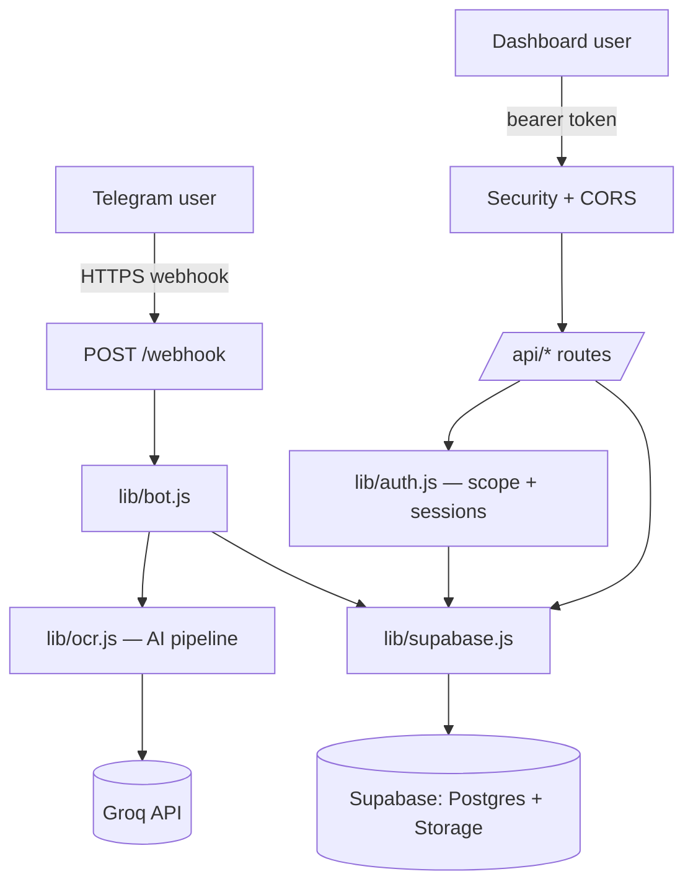

# System Architecture

## Purpose
How the parts fit together and how a request flows through the system.

## Overview
A single **stateless Node.js process** (Express) with all state in Supabase — any always-on host works, and redeploys/rollbacks are safe. Two entry channels — the **Telegram webhook** and the **web dashboard/API** — meet at the same core services.

## Key Components
| Layer | Files | Responsibility |
|---|---|---|
| Entry/wiring | `server.js` | Mounts middleware + routes; starts server; registers webhook |
| Middleware | `security-headers.js`, `cors-preflight.js` | CSP/security headers; CORS preflight |
| Telegram | `webhook.js`, `bot.js`, `telegram.js` | Receive updates, run bot logic, send replies |
| AI pipeline | `ocr.js`, `groq.js`, `categorize.js`, `confidence.js` | Read receipts, extract, categorise, score |
| Web API | `routes/*.js` | Expenses, reports, review, agent, upload, business admin |
| Identity/isolation | `auth.js`, `supabase.js`, `account.js` | Login/sessions, scope checkpoint, capability flags |
| Business logic | `branches.js`, `pettyCash.js`, `statement*.js`, `reports.js` | Branches/staff, petty-cash maths, statements, reports |
| Data | Supabase | All persistent state |

## How It Works
**Telegram flow:** update hits `/webhook` (secret-gated) → `bot.js` resolves what it is (photo/PDF/album/menu/text) and, in business mode, the chat's binding → photos/PDFs go through `ocr.js` → Groq → saved via `supabase.js` → bot replies (and asks for staff tag in business mode).

**Dashboard flow:** browser calls `/api/*` with a bearer token → `checkDash` gate → in business mode the token resolves to a session → scope (`account_id` + role + branch/company) → `supabase.js` applies that scope to every query, so a clerk only ever sees their own branch → JSON returned, rendered by the vanilla-JS frontend.

## Design Principles
- One codebase, capability flags — no personal/business fork.
- One isolation checkpoint — every business query goes through `scopeForUser` + `lib/supabase.js`.
- Stateless app, stateful database.
- Secrets stay server-side only.

## Notes
- The bot keeps small, short-lived state in memory (e.g. "which receipt is being tagged"); a restart clears it harmlessly — records are always saved first.
- Model IDs are configuration; a model deprecation is a settings change.
