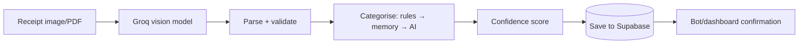

# AI Workflow

## Purpose
How the system turns a receipt image into structured, categorised data, and how the dashboard agent answers questions.

## Overview
AI is provided by **Groq-hosted models** via an OpenAI-compatible chat API (`lib/groq.js`). Three jobs: **vision OCR**, **categorisation**, and the **dashboard agent**. Model choice is configuration (`lib/config.js → MODEL_ROUTES`), so a deprecation is a settings change, not code.

| Job | Default model | Where |
|---|---|---|
| Vision (receipt reading) | `qwen/qwen3.6-27b` | `lib/ocr.js` |
| Text/agent | `llama-3.3-70b-versatile` | `lib/agent.js` |
| Classify (category) | `openai/gpt-oss-20b` | `lib/categorize.js` |

## Key Components
- **`groq.js`** — shared request runner; API-key pool rotation + backoff on rate limits.
- **`ocr.js`** — prepare image → vision model → parse → validate → assemble expense.
- **`categorize.js` + `categoryMemory.js`** — rules, learned corrections, AI classifier.
- **`confidence.js`** — marks fields high/low confidence.
- **`agent.js` + `agentProposals.js`** — dashboard chat agent + tool-calling loop.

## How It Works

1. Image (or each PDF page) sent to the vision model with an extraction prompt.
2. `ocr.js` parses and validates the reply (dates kept flexible so bad OCR never crashes a save).
3. Category decided in order: **rules → learned corrections → AI classifier**.
4. Each field gets a confidence label; low-confidence key fields can trigger a bot follow-up.
5. Record saved; business mode later adds a staff tag.

**Dashboard agent:** the user asks a question (`POST /api/agent`) → the model is given tools to query expense data → it calls them, reads results, replies in plain language. Any proposed action is confirmed separately (`/api/agent/confirm`) before anything changes.

## Reliability & Notes
- **Key pooling** — multiple Groq keys rotate on rate-limit with no delay; single key = simple retry/backoff.
- **Abuse guards** — PDF byte-size/pixel caps checked **before** any AI call.
- **Graceful degradation** — categorisation still works (rules + AI) if learning data is absent.
- Raw model output is stored per expense for debugging/audit.
- **Data privacy:** regulated clients get the AI provider's **Zero-Data-Retention** mode; provider swap is a config point. Enabling it live is an operational step — **Requires Manual Review** per instance.
