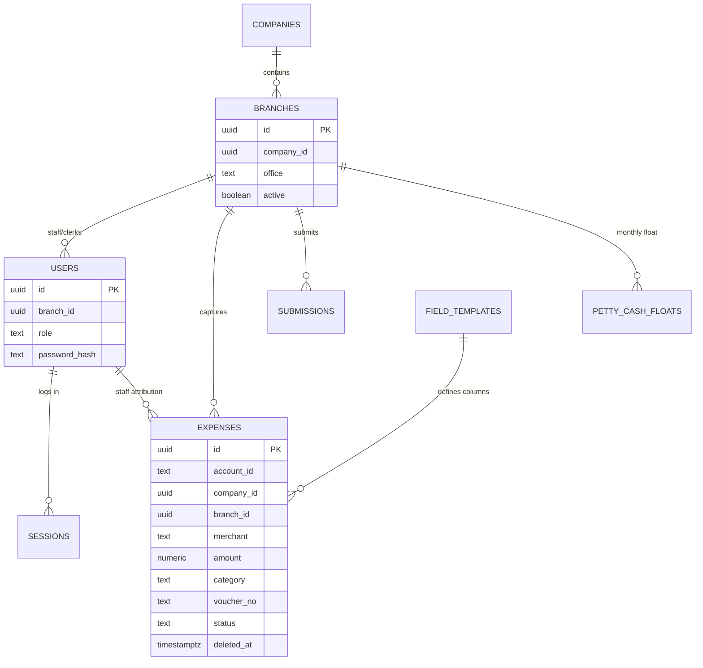

# Database Overview

## Purpose
The data model: what's stored, how tables relate, and how tenant/branch isolation works.

## Overview
Database is **Supabase (PostgreSQL)**; full schema in `schema.sql`, applied once per client. Every row carries `account_id` (one account = one client instance). Business tables add `company_id`/`branch_id` for finer partitioning. The server connects with the **service-role key**; RLS is **enabled on every table with no public policy** (anonymous access denied).

## Key Components (tables)
| Table | Purpose |
|---|---|
| `expenses` | Core record — one row per captured receipt |
| `field_templates` | Per-account custom columns + category set |
| `category_corrections` | Learned category fixes |
| `voucher_counters` | Per-account/year counter behind voucher numbers |
| `account_settings` | Per-account UI preferences |
| `companies` | (Business) top level — a legal entity |
| `branches` | (Business) HQ + offices |
| `users` | (Business) admin/clerk logins + staff directory |
| `sessions` | (Business) opaque sessions (hash only stored) |
| `bot_bindings` | (Business) links a Telegram chat to a user/branch/role |
| `submissions` | (Business) "Send to Admin" per branch × month |
| `petty_cash_floats` / `cash_in` | (Business) monthly float + top-ups |

## Relationships

## How It Works
- **Tenant key:** every table filtered by `account_id` — one instance = one client.
- **Business partitioning:** `branch_id`/`company_id` narrow a clerk to their slice; null for personal accounts.
- **Soft delete:** expenses hidden via `deleted_at`, never physically removed.
- **DB-generated values:** voucher numbers and `updated_at` set by database triggers, so every write path gets them automatically. An atomic upsert powers race-free category learning.
- **Computed, not stored:** petty-cash claim status is calculated on read, so it can't drift from the numbers.

## Notes
- Isolation today = application layer (`scopeForUser` checkpoint + service-role key); JWT-scoped RLS is a **later hardening step** (commented in `schema.sql`).
- Business tables were added additively — personal data was never migrated or disturbed.
- Legacy rows before the company dimension have `company_id = null`; queries are null-tolerant so they stay visible.
