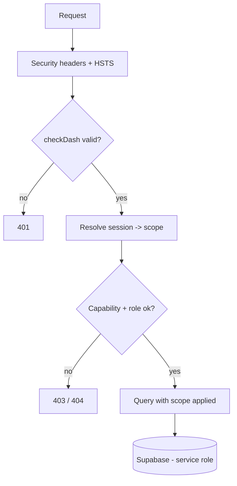

# Security

## Purpose
Authentication, isolation, data protection, and hardening controls.

## Overview
Layered security: secrets stay server-side, every data route is token-gated, business data is isolated at one enforced checkpoint, and every response carries strict security headers.

## Key Components

**Authentication & sessions**
- Dashboard bearer token (`DASHBOARD_TOKEN`) gates every `/api/*` + `/receipt` route; **fails closed** in production if unconfigured.
- Business login: passwords hashed with **scrypt** (memory-hard, Node core, no extra dependency).
- Sessions are opaque random tokens; only the **SHA-256 hash** is stored — a leaked DB dump can't be replayed. Default 12h expiry, revocable per user.

**Isolation (multi-branch/company)**
- One checkpoint: `scopeForUser(user)` → `{account_id, role, branch/company}`. `lib/supabase.js` applies it to **every** query and stamps it on **every** insert — no route hand-rolls its own filter.
- Clerk = hard-filtered to own branch/company. Admin = sees all by design. Staff never log in.
- Company filter is **null-tolerant** — legacy rows stay visible, cross-company reads still blocked.
- Independent isolation audits + two-direction automated tests are standing practice.

**Data protection**
- Secrets server-side only — browser never talks to Supabase/AI provider directly.
- Service-role key used by the server; RLS enabled with **no anonymous policy** anywhere.
- No PII in logs — structured error logs record message + scalar route context only.
- Soft delete keeps financial records recoverable and auditable.

**HTTP hardening** (`lib/security-headers.js`)
| Header | Effect |
|---|---|
| Content-Security-Policy | Same-origin scripts/styles only, no inline |
| X-Content-Type-Options / X-Frame-Options | No MIME sniffing / no clickjacking |
| Referrer-Policy / Permissions-Policy | No referrer leak; camera/mic/geo disabled |
| Cross-Origin-Resource-Policy | Others can't read our responses |
| Strict-Transport-Security | Enforced on HTTPS |
| Cache-Control: no-store | On `/api/*` and `/receipt` |

**Input & abuse controls**
- Webhook secret required for Telegram updates; chat allowlist covers button taps too.
- Per-route body-size limits + rate limiters (login, agent, upload, statement, admin).
- PDF/upload byte-size + rendered-pixel caps checked **before** any AI call.
- Generic errors only; no raw SQL (PostgREST + encoded params).

## How It Works

## Notes — pre-launch gates (before real customers)
Rotate all dev-used secrets · enable AI provider Zero-Data-Retention for regulated clients · hold an independent DB backup · return demo-relaxed rate limits to production values. **Future hardening (recorded, not yet enabled):** JWT-scoped RLS at the DB layer; shorter session expiry/auto-logout.
